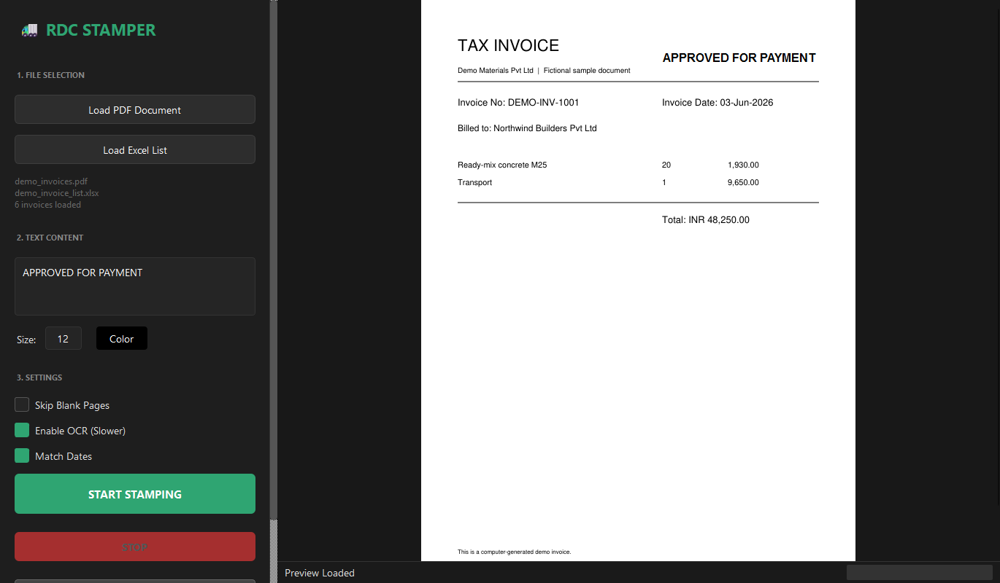
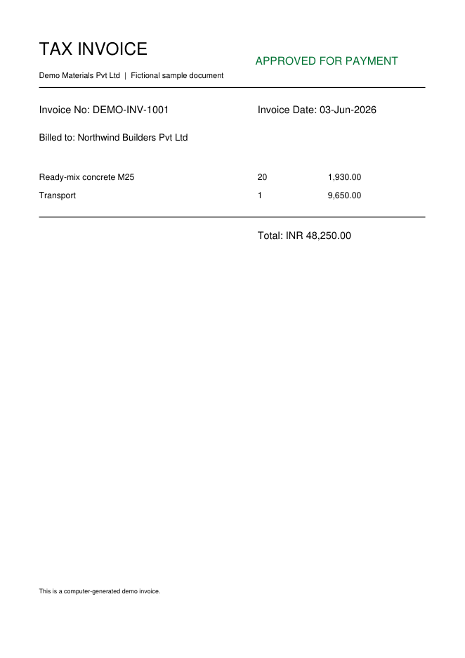

# RDC Stamper V2

A Windows desktop tool that checks a bundle of scanned invoice PDFs against an Excel invoice list, **stamps only the pages that match** (for example "APPROVED FOR PAYMENT"), and writes an **Excel verification report** showing exactly what was verified, duplicated, mismatched or missing.

It was built for finance operations, where hundreds of invoice pages had to be matched to a payment list and stamped by hand. A full batch now takes minutes, and every decision is recorded in the report.

> **About the samples:** everything in `samples/` and in the screenshots is fictional and produced by [`samples/generate_demo_data.py`](samples/generate_demo_data.py). No real invoices or customer data are included.



## What it does

1. **Load** one or more PDFs (several files are merged automatically) and an Excel or CSV list of invoice numbers and dates.
2. **Position the stamp** by dragging the text on the live preview of page 1. Choose the text, size and colour.
3. **Start.** Every page is analysed in parallel. The app finds the invoice number on each page, reads the invoice date, and compares both with your list.
4. **Get two outputs:** a PDF containing only the verified, stamped pages, and `<name>_Report.xlsx` with one row per invoice.

### Matching rules

| Situation | Result |
|---|---|
| Invoice number and date both match the list | `✓ Verified`, stamped |
| Invoice number matches, date cannot be read from the page | `⚠ Partial (Date?)`, stamped |
| Date differs and **Match Dates** is on | `✗ Date Mismatch`, not stamped |
| Date differs and **Match Dates** is off | `⚠ Stamped (Date Mismatch)`, stamped |
| Same invoice number and date appears on another page | `⚠ Duplicate - Skipped` |
| Listed in Excel but never found in the PDF | `✗ Not Found in PDF` |
| Page is blank (with **Skip Blank Pages** on) | ignored |

With no Excel list loaded, the app can stamp every non-blank page instead.

### Sample run

The demo bundle has 7 pages: five invoices, a duplicate of one of them, and a blank page. One invoice is printed with a date that differs from the list. The list has 6 rows, and one of them is not in the PDF. With **Match Dates** on, **4 of the 7 pages are stamped**, and the report looks like this:

| Invoice No | Excel Date | PDF Date | Date Match | Status |
|---|---|---|---|---|
| DEMO-INV-1001 | 2026-06-03 | 2026-06-03 | ✓ | ✓ Verified |
| DEMO-INV-1002 | 2026-06-04 | 2026-06-04 | ✓ | ✓ Verified |
| DEMO-INV-1003 | 2026-06-04 | 2026-06-04 | ✓ | ✓ Verified |
| DEMO-INV-1004 | 2026-06-10 | 2026-06-09 | ✗ | ✗ Date Mismatch |
| DEMO-INV-1005 | 2026-06-11 | 2026-06-11 | ✓ | ✓ Verified |
| DEMO-INV-1002 | 2026-06-04 | 2026-06-04 | DUPLICATE | ⚠ Duplicate - Skipped |
| DEMO-INV-1099 | 2026-06-12 | | N/A | ✗ Not Found in PDF |

The stamped output (`samples/demo_output_stamped.pdf`):



## Features

- **Invoice-number and date verification** against an Excel/CSV list. The date parser accepts numeric, ISO and named-month formats (`13-06-26`, `2026-06-13`, `13th June, 2026`, `Jun 13 2026`) and prefers the value next to the "Invoice Date" label, so it does not pick up the acknowledgement or posting date by mistake.
- **Offline OCR fallback** with a bundled portable Tesseract for image-only scans. It runs only when the text layer has no match.
- **Parallel page analysis** with a worker pool sized to the CPU, a progress bar, and a stop button. Large files (over 100 MB) skip the slow PDF defragmentation step on save.
- **Drag-and-drop stamp placement** on a rendered preview. The position is stored relative to the page, so it lands in the same place on every page.
- **Duplicate and blank page handling,** so repeated scans are not stamped twice.
- **One-file Windows installer** (PyInstaller + Inno Setup) that bundles the Python runtime, Qt and Tesseract. Nothing else needs to be installed on the target PC.

## Tech stack

Python, PySide6 (Qt), PyMuPDF, pandas, openpyxl, Pillow, pytesseract (Tesseract OCR), PyInstaller, Inno Setup.

## Project structure

```
src/rdc_stamper/
  app.py              PySide6 UI: preview, draggable stamp, settings
  stamper_engine.py   matching, date extraction, OCR fallback, stamping, report
  tesseract/          portable Tesseract goes here (not in the repo, see below)
tests/                unit tests (date parsing, Excel loading, temp-file handling)
samples/              generator for the fictional demo PDF and Excel list, plus sample output
specs/                PyInstaller specs
installer/            Inno Setup script and build script
```

## Run from source

Requires Windows and Python 3.10+.

```bash
python -m venv venv
venv\Scripts\activate
pip install -r requirements.txt
python src\rdc_stamper\app.py
```

You can also double-click `run.bat`. OCR is optional when running from source: the app uses a Tesseract found in `src/rdc_stamper/tesseract/`, otherwise one on your `PATH`.

Try it with the demo files: load `samples/demo_invoices.pdf` and `samples/demo_invoice_list.xlsx`. Regenerate them any time with `python samples/generate_demo_data.py`.

### Tests

```bash
python -m unittest discover -s tests -v
```

## Build the Windows installer

1. Download a portable Tesseract build for Windows and copy `tesseract.exe`, its DLLs and `tessdata\eng.traineddata` into `src/rdc_stamper/tesseract/`. The binaries are about 240 MB, so they are git-ignored.
2. Install Inno Setup 6 once: `winget install --id JRSoftware.InnoSetup --exact`
3. Run:

   ```powershell
   .\build-installer.bat                 # or: .\build-installer.bat -Version 2.1.0
   ```

The installer is written to `installer-output\RDC_Stamper_V2_Setup_<version>_x64.exe`. It targets 64-bit Windows 10 (1809+) and Windows 11, creates an uninstall entry and a Start menu shortcut, and is unsigned, so SmartScreen may warn until it is code-signed.

## Limitations

- Windows only: PySide6 itself is cross-platform, but the installer and the bundled OCR are Windows builds.
- The invoice number must be present as text or be readable by OCR. Poor scans may need the OCR option and a manual check of the report.
- Invoice numbers are matched as exact text. The Excel list columns are found by the names `Invoice No`, `Invoice Number` or `Invoice_No` (the first column is used otherwise), and `Invoice Date` or `Date` for dates.

## Author

Built by [Jarjish Siddibapa](https://github.com/jarjishSiddibapa) at RDC Concrete. See also the [portfolio](https://jarjishsiddibapa.github.io/jarjish-portfolio-website/).
